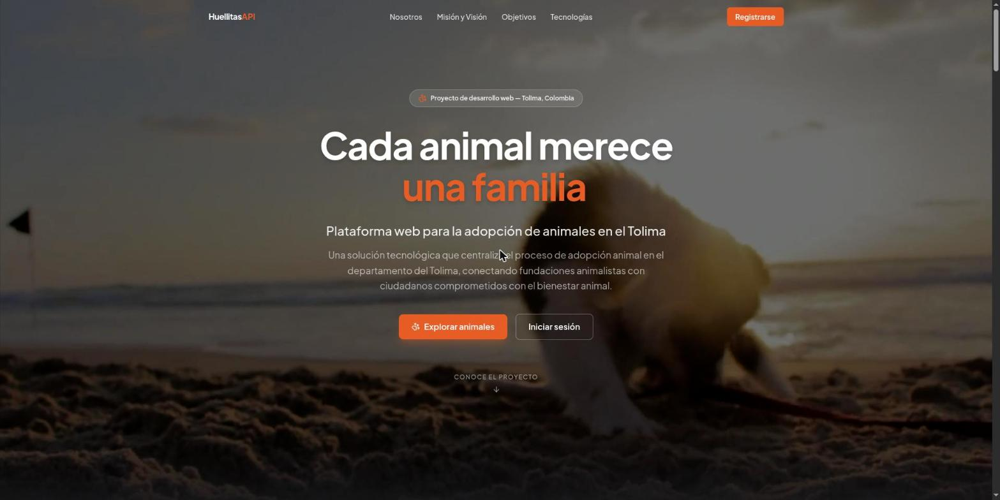
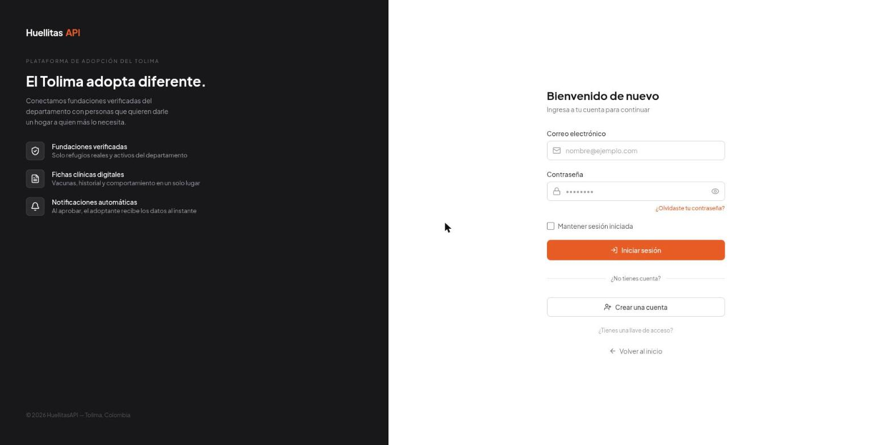
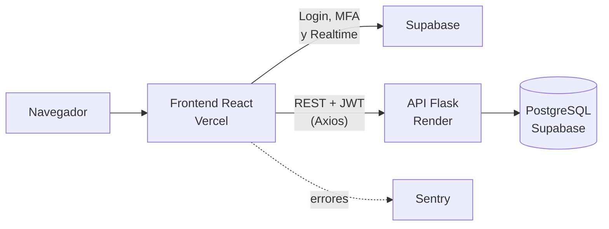

# Huellitas — Frontend

Plataforma web de adopción de animales para el departamento del Tolima (Colombia). Conecta **fundaciones animalistas** con **personas que quieren adoptar**: las fundaciones publican sus mascotas, los ciudadanos envían solicitudes y agendan visitas, un administrador supervisa la plataforma y los desarrolladores externos consumen una API pública.


| | |
|---|---|
| **Demo en vivo** | [huellitas-frontend-gamma.vercel.app](https://huellitas-frontend-gamma.vercel.app) |
| **Backend (API Flask)** | [MurilloR11/huellitas-backend](https://github.com/MurilloR11/huellitas-backend) |

<p align="center">
  
  
</p>

---

## Probar la demo

Cada rol tiene su propio flujo y sus propias rutas. Puedes entrar con estas cuentas de prueba:

| Rol | Correo | Contraseña | Qué puedes ver |
|---|---|---|---|
| Ciudadano | `demo.ciudadano@example.com` | `Demo-3tBHLoV5!` | Explorar mascotas, requisitos y flujo de solicitud de adopción |
| Fundación | `demo.fundacion@example.com` | `Demo-aebtpxdn!` | Panel de la fundación: mascotas, solicitudes y disponibilidad de visitas |
| Administrador | `demo.admin@example.com` | `Demo-ajkD7bIA!` | Panel admin: estadísticas, usuarios, fundaciones, mascotas y actividad |
| Developer | `demo.developer@example.com` | `Demo-99bXGtt0!` | Portal de desarrolladores y documentación de la API (Swagger) |

> **Modo demo de solo lectura:** estas cuentas pueden navegar todas las pantallas, pero el backend bloquea cualquier acción que cree, edite o borre datos. En el panel admin, los correos de los usuarios reales aparecen enmascarados.
>
> El backend está en el plan gratuito de Render: si lleva un rato sin uso, la primera petición puede tardar hasta ~50 segundos mientras el servidor despierta.

## Contenido

- [Roles y flujos](#roles-y-flujos)
- [Arquitectura](#arquitectura)
- [Stack](#stack)
- [Pruebas](#pruebas)
- [Estructura del proyecto](#estructura-del-proyecto)
- [Cómo correrlo en local](#cómo-correrlo-en-local)
- [Detalles de la interfaz](#detalles-de-la-interfaz)

---

## Roles y flujos

La aplicación tiene **4 roles**. Cada ruta privada está protegida con un componente `ProtectedRoute` que revisa la sesión y el rol del usuario y, si no tiene permiso, lo redirige.

| Rol | Rutas principales | Qué puede hacer |
|---|---|---|
| **Ciudadano** | `/explore`, `/adopt`, `/my-adoptions`, `/adoptions/:id`, `/account` | Explorar mascotas con filtros, llenar el formulario de adopción, subir documentos, agendar la visita y seguir el estado de cada solicitud en tiempo real |
| **Fundación** | `/foundation/dashboard` | Publicar mascotas con fotos, revisar y responder solicitudes, y definir su disponibilidad para visitas. Si la cuenta aún no está aprobada, ve `/pending` o `/rejected` |
| **Administrador** | `/admin`, `/admin/fundaciones`, `/admin/usuarios`, `/admin/mascotas`, `/admin/solicitudes`, `/admin/actividad` | Aprobar o rechazar fundaciones, bloquear usuarios, suspender mascotas, cancelar adopciones y revisar estadísticas y actividad |
| **Developer** | `/developer/dashboard` | Crear y revocar llaves de API, ver estadísticas de uso y probar la API pública desde la documentación Swagger integrada |

**Seguridad de la cuenta.** Inicio de sesión con Supabase Auth, doble factor (MFA con TOTP), códigos de respaldo, recuperación de contraseña por código OTP y validación de formularios con Zod antes de cada envío.

## Arquitectura



- **Autenticación:** el frontend inicia sesión directamente con Supabase Auth. El JWT se envía al backend en cada petición desde una instancia de Axios (`shared/lib/apiClient.ts`).
- **Estado del servidor:** TanStack Query maneja las peticiones, la caché y los reintentos. Las suscripciones de Supabase Realtime (`useRealtimeTable`) invalidan la caché cuando cambian las solicitudes, las visitas, las mascotas o las notificaciones, así que la pantalla se actualiza sin recargar.
- **Organización por *features*:** cada dominio (`auth`, `pets`, `adoptions`, `admin`, etc.) tiene sus propias páginas, componentes, servicios de API y tipos. El código compartido vive en `shared/`.
- **Build:** las páginas por rol se cargan con `React.lazy` y Vite separa las dependencias compartidas (React, TanStack Query, Radix, Supabase, Sentry y Framer Motion) en *chunks* propios con `manualChunks`.

## Stack

| Tecnología | Uso |
|---|---|
| React 19 + TypeScript | Interfaz y tipado estático |
| Vite | Bundler y servidor de desarrollo |
| Tailwind CSS 4 + shadcn/ui (Radix) | Estilos y componentes accesibles |
| React Router 7 | Rutas públicas y protegidas por rol |
| TanStack Query | Estado del servidor, caché y reintentos |
| Supabase JS | Autenticación, MFA y suscripciones en tiempo real |
| Axios | Cliente HTTP hacia la API Flask |
| Zod | Validación de formularios |
| Recharts | Gráficas del panel de administración |
| Swagger UI | Documentación interactiva de la API pública |
| Sentry | Monitoreo de errores en producción |
| Vitest + Testing Library | Pruebas unitarias y de componentes |
| Playwright | Pruebas de extremo a extremo (E2E) |

## Pruebas

```bash
npm run test:run        # pruebas unitarias (una pasada)
npm run test:coverage   # con reporte de cobertura
npm run test:e2e        # pruebas E2E con Playwright
```

- **165 pruebas unitarias** con Vitest y Testing Library, en 27 archivos, todas en verde. Cubren el contexto de autenticación, los servicios de login y registro (con el cliente HTTP simulado), el cliente HTTP, el router, la configuración de TanStack Query y los componentes de la página de inicio.
- **5 pruebas E2E con Playwright:** la página de inicio, el login (mostrar y ocultar contraseña), el registro (cambio de tipo de cuenta), la carga de una página diferida y la redirección al login de una ruta privada.
- **Cobertura:** `npm run test:coverage` genera el reporte. El umbral está configurado en `vite.config.ts`, y la cobertura actual se concentra en autenticación, router y landing. Las páginas de los paneles todavía no tienen pruebas.

### Rendimiento

Las páginas de cada rol se cargan **bajo demanda** con `React.lazy`, y las dependencias grandes van en *chunks* separados. Así, quien entra a la landing no descarga Swagger, las gráficas ni el generador de PDF.

| | Antes | Ahora |
|---|---|---|
| JS de la carga inicial | 3.540 kB (990 kB gzip) | **1.135 kB (340 kB gzip)** |
| Archivo principal (`index`) | 2.359 kB | **193 kB (50 kB gzip)** |

## Estructura del proyecto

```
src/
├── app/            # Router, providers y contexto de autenticación
├── features/       # Un módulo por dominio
│   ├── account/    #   Perfil, MFA, códigos de respaldo
│   ├── admin/      #   Panel de administración
│   ├── adoptions/  #   Formulario, documentos, agenda y seguimiento
│   ├── auth/       #   Login, registro, esquemas Zod, servicios
│   ├── developer/  #   Llaves de API, estadísticas y Swagger
│   ├── foundations/
│   ├── home/       #   Landing
│   ├── notifications/
│   └── pets/
└── shared/         # UI reutilizable (atoms, molecules, organisms), hooks, cliente HTTP
e2e/                # Pruebas Playwright
```

## Cómo correrlo en local

**Requisitos:** Node.js 18 o superior y el [backend](https://github.com/MurilloR11/huellitas-backend) corriendo (por defecto en `http://localhost:5000`).

```bash
git clone https://github.com/MurilloR11/huellitas-frontend.git
cd huellitas-frontend
npm install
cp .env.example .env.local   # y completa las variables
npm run dev                  # http://localhost:5173
```

| Variable | Descripción |
|---|---|
| `VITE_API_URL` | URL de la API Flask |
| `VITE_SUPABASE_URL` | URL del proyecto de Supabase |
| `VITE_SUPABASE_ANON_KEY` | Llave pública `anon` de Supabase (no la `service_role`) |
| `VITE_SENTRY_DSN` | Opcional: activa el monitoreo de errores |

Otros scripts: `npm run build` (build de producción), `npm run preview` y `npm run lint`.

## Detalles de la interfaz

La landing tiene un cursor personalizado en forma de huella, un hero con efecto de máquina de escribir, un carrusel infinito de tecnologías hecho solo con CSS (`@keyframes`, se pausa al pasar el cursor) y una navbar que pasa de transparente a blanca al hacer scroll.

---

Desarrollado por **Santiago Murillo Montealegre** como proyecto de grado de Tecnología en Gestión Informática (UniEspinal, 2026).
[GitHub](https://github.com/MurilloR11) · [LinkedIn](https://linkedin.com/in/santiago-murillo-99137a297)
